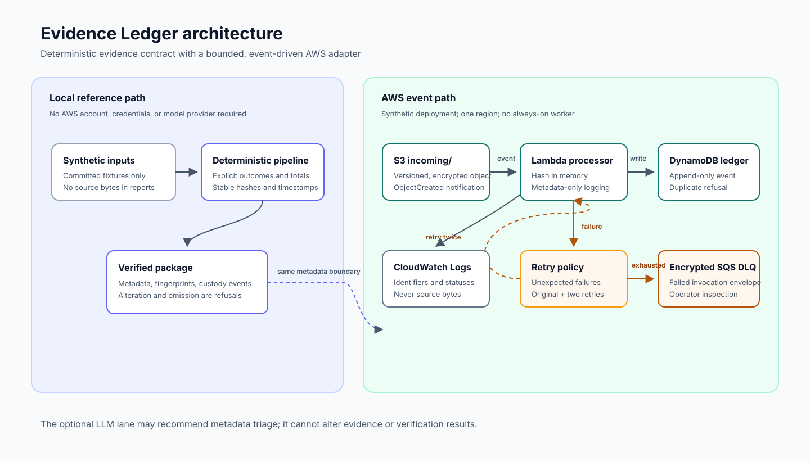
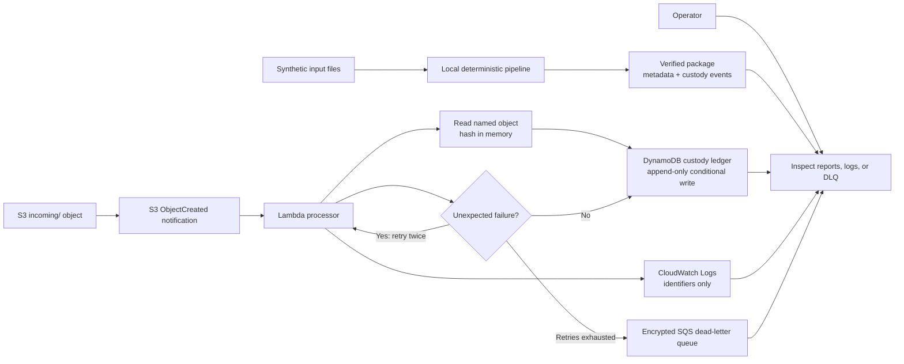

# Evidence Ledger architecture

This diagram shows the smallest complete path. The local deterministic path is the
reference contract; the AWS path exercises the same metadata boundary through an
event-driven deployment.

## Trust and data boundaries

- The input boundary accepts only synthetic fixtures in this portfolio project.
- S3 stores the source object with versioning, short governance retention, public-access
  blocking, and server-side encryption.
- Lambda receives an object location and bounded metadata; it does not print or return
  source bytes.
- DynamoDB stores metadata and custody events, not a second copy of the source object.
- The failure queue stores failed invocation envelopes for inspection. It has no automatic
  replay consumer in this small, low-cost deployment.
- The optional LLM lane, if added later, may recommend metadata triage only. It cannot
  alter evidence, custody history, approval state, or verification results.

## Deliberate limits

S3 notifications are at-least-once delivery, so duplicate handling is part of the
contract. The single-region deployment does not establish regional recovery or
production-scale concurrency. A DLQ preserves a failed invocation but does not replace
alerting, ownership, replay policy, or incident response.
